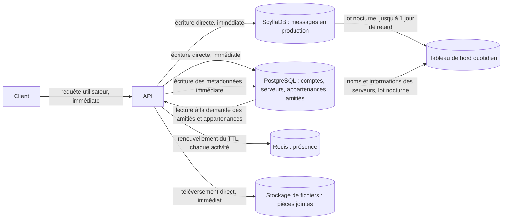

# DOSSIER D'ARCHITECTURE DES DONNÉES — DISCORD

Dans ce dossier, j'essaie de comprendre comment organiser les données d'une petite plateforme inspirée de Discord. Les chiffres tirés des articles sont ceux qui sont rapportés dans les documents. Quand je fais une estimation, je le précise. Les choix proposés sont mes idées pour le projet, ils ne décrivent pas forcément le fonctionnement réel de Discord.

## 0. Résumé en cinq lignes

En 2016, Discord passe d'environ 40 millions à 100 millions de messages par jour, puis dépasse 120 millions. Vers 100 millions de messages stockés, MongoDB ne garde plus les données et l'index en mémoire ; les temps de réponse deviennent imprévisibles. Les lectures sont très aléatoires et les serveurs n'ont pas tous le même usage : certains relisent des messages anciens, d'autres surtout les messages récents. Cassandra permet de répartir les messages, mais les partitions chaudes, les tombstones et les pauses du ramasse-miettes créent de nouveaux problèmes. Discord passe ensuite à ScyllaDB et ajoute des services en Rust qui regroupent les lectures identiques.

## 1. Ce que le système peut garantir

Pour commencer, je vois la plateforme comme un ensemble de comptes, de serveurs, de salons et de messages, avec aussi les amitiés, la présence et un tableau de bord. Un même utilisateur peut rejoindre plusieurs serveurs. Chaque serveur a un propriétaire qui en est aussi membre. Les salons sont textuels ou vocaux, et deux salons du même serveur ne peuvent pas avoir le même nom. Un message peut être envoyé seulement dans un salon textuel et son auteur doit être membre du serveur. Enfin, une amitié ne doit pas apparaître deux fois et la présence expire après cinq minutes sans activité.

Pour les essais du jour 2, le projet miniature prévoit environ **5 000 utilisateurs, 150 serveurs, 970 salons, 300 000 messages** répartis de façon inégale et **15 000 amitiés**.

### 1.a — Le système vu de l'extérieur

**Acteurs**

| Acteur       | Description                                                        |
| ------------ | ------------------------------------------------------------------ |
| Utilisateur  | Personne qui possède un compte.                                    |
| Membre       | Utilisateur qui a rejoint un serveur.                              |
| Modérateur   | Membre qui peut notamment supprimer des messages d'autres membres. |
| Propriétaire | Membre qui possède un serveur et peut gérer ses salons.            |

**Objets métier**

| Objet | Informations importantes |
|---|---|
| Utilisateur | Identifiant, pseudo et e-mail unique. |
| Serveur | Communauté créée et gérée par un propriétaire. |
| Salon | Salon d'un serveur, de type textuel ou vocal. |
| Message | Auteur, salon, contenu, date d'envoi et date de modification facultative. |
| Pièce jointe | Image, fichier ou lien associé éventuellement à un message. |
| Amitié | Relation acceptée entre deux utilisateurs, symétrique et unique par paire. |
| Présence | Dernier statut en ligne, valable cinq minutes après la dernière activité. |
| Tableau de bord | Nombre de messages et d'auteurs distincts par jour et par serveur. |

**Cycle de vie**

| Acteur | Action | Objet |
|---|---|---|
| Utilisateur | crée | un serveur et en devient propriétaire |
| Propriétaire | crée ou supprime | un salon ou un serveur |
| Utilisateur | rejoint ou quitte | un serveur |
| Membre | écrit ou supprime | son message |
| Modérateur | supprime | le message d'un autre membre |
| Utilisateur | accepte ou retire | une amitié |
| Utilisateur | actualise | sa présence en envoyant un signe de vie |
| Système | calcule | le tableau de bord quotidien |

**Glossaire**

| Terme | Définition |
|---|---|
| Serveur | Communauté qui regroupe des membres et des salons. |
| Salon | Espace textuel ou vocal à l'intérieur d'un serveur. |
| Membre | Utilisateur qui a rejoint un serveur. |
| Propriétaire | Membre qui a le rôle de propriétaire dans un serveur. |
| Modérateur | Membre qui a des droits de modération. |
| Amitié | Lien accepté et réciproque entre deux utilisateurs. |
| Présence | Statut en ligne qui expire après cinq minutes sans activité. |
| Pièce jointe | Image, fichier ou lien associé à un message. |
| Auteur | Utilisateur qui a écrit un message. |
| Occurrence | Exemple concret d'une entité ; Alice est une occurrence d'UTILISATEUR. |

### 1.b — Règles de gestion

| Règle                                                                             | Garantie par le modèle                                                     | Garantie par le code ou un traitement                                                      | Hors du modèle relationnel                                                 |
| --------------------------------------------------------------------------------- | -------------------------------------------------------------------------- | ------------------------------------------------------------------------------------------ | -------------------------------------------------------------------------- |
| Un utilisateur a un pseudo et un e-mail unique.                                   | Champs obligatoires et `UNIQUE(email)`.                                    | Aucune                                                                                          | Aucune                                                                          |
| Un serveur a exactement un propriétaire, qui en est membre.                       | Le rôle est enregistré sur l'appartenance.                                 | Vérifier qu'il y a exactement un propriétaire par serveur.                                 | Aucune                                                                          |
| Le rôle d'un membre vaut propriétaire, modérateur ou membre.                      | `CHECK` sur la valeur du rôle.                                             | Aucune                                                                                          | Aucune                                                                          |
| Un serveur contient des salons ; le nom d'un salon est unique dans ce serveur.    | Clé étrangère vers serveur et `UNIQUE(id_serveur, nom)`.                   | Aucune                                                                                          | Aucune                                                                          |
| Un salon est textuel ou vocal.                                                    | `CHECK(type IN ('textuel','vocal'))`.                                      | Aucune                                                                                          | Aucune                                                                          |
| Un message a un auteur, un salon, un contenu et une date d'envoi.                 | Clés étrangères et champs obligatoires ; date de modification facultative. | Aucune                                                                                          | Aucune                                                                          |
| Seuls les salons textuels reçoivent des messages.                                 | Une contrainte simple ne suffit pas, car il faut lire le type du salon.    | Vérification à l'envoi du message.                                                         | Aucune                                                                          |
| Pour écrire, l'auteur doit être membre du serveur du salon.                       | Les clés étrangères seules ne suffisent pas à vérifier les deux chemins.   | Vérification de l'appartenance avant l'écriture.                                           | Aucune                                                                          |
| Une amitié entre deux utilisateurs est enregistrée une seule fois.                | Couple d'identifiants unique et convention `id_a < id_b`.                  | Aucune                                                                                          | Aucune                                                                          |
| Une présence expire après cinq minutes sans activité.                             | Champ date d'expiration possible.                                          | Renouveler l'expiration à chaque signe de vie et supprimer/ignorer les présences expirées. | Un cache avec TTL comme Redis est une solution possible.                   |
| Un tableau de bord quotidien contient les messages et auteurs distincts par jour. | Table ou vue agrégée.                                                      | Calcul et rafraîchissement une fois par jour.                                              | Aucune                                                                          |
| Les pièces jointes peuvent être de formes différentes.                            | Le modèle peut garder un type et des métadonnées JSON.                     | Valider les champs selon le type.                                                          | Les gros fichiers peuvent être gardés dans un stockage de fichiers/objets. |
| Les suggestions utilisent les amis des amis et les serveurs de ces amis.          | Tables d'amitié et d'appartenance.                                         | Parcourir les relations et éliminer les doublons.                                          | Une base graphe peut aider si le parcours devient trop coûteux.            |

J'ai choisi de mettre `role` directement sur l'appartenance, parce que les rôles du projet sont toujours les mêmes. Si chaque serveur pouvait créer ses propres rôles et permissions, cette solution ne suffirait plus : il faudrait probablement une entité ROLE.

### 1.c — MCD du noyau

J'ai compris que le MCD sert à dessiner les éléments importants et les liens entre eux, avant de décider dans quelles tables les ranger. Les nombres près des liens indiquent les cardinalités : le minimum puis le maximum de participations.

**Entités et associations.** Je garde UTILISATEUR, SERVEUR, SALON et MESSAGE comme entités. Par exemple, un serveur peut contenir plusieurs salons, mais chaque salon dépend d'un seul serveur. Un message a aussi un seul auteur et se trouve dans un seul salon. Je garde MESSAGE comme entité car il a son propre identifiant, un auteur, des dates et un cycle de vie : il peut être modifié ou supprimé. Le transformer en simple attribut du salon rendrait ces actions difficiles à représenter. La phase 3 pourra changer sa façon d'être stocké sans changer ce modèle conceptuel.

**Appartenance et rôle.** Un utilisateur peut rejoindre plusieurs serveurs et chaque serveur peut avoir plusieurs membres. J'ai mis le rôle (`membre`, `moderateur` ou `proprietaire`) sur l'association d'appartenance. C'est suffisant parce que la liste des rôles est fixe. Je n'ajoute donc ni entité ROLE ni table de rôles séparée. Si les serveurs pouvaient créer des rôles et des permissions, il faudrait plutôt les modéliser comme des objets à part.

**Amitié réflexive.** Ici, une amitié relie deux utilisateurs, donc UTILISATEUR est relié à lui-même. L'amitié est la même dans les deux sens : Alice-Bob, c'est aussi Bob-Alice. Pour éviter de l'enregistrer deux fois, je range toujours les identifiants dans le même ordre (`id_a < id_b`) et je rends le couple unique. Cette règle évite aussi qu'une personne soit amie avec elle-même.

**Propriétaire.** J'ai choisi de représenter le propriétaire avec le rôle de membre. Si j'ajoutais en plus un lien séparé vers le propriétaire, les deux informations pourraient se contredire : le lien pourrait nommer Alice et le rôle nommer Bob. Il faut donc contrôler qu'il y a exactement un membre propriétaire par serveur.

**Pièces jointes.** Dans le périmètre actuel, un message peut n'avoir aucune pièce jointe ou en avoir une. Je garde la pièce jointe comme élément séparé, avec son type et son emplacement. Les détails ne sont pas toujours les mêmes pour une image, un fichier ou un lien ; les mettre tous dans des colonnes fixes serait vite gênant. On peut donc ranger ces détails dans un document JSON ou un stockage adapté. Si le projet autorise plusieurs pièces jointes, il faudra changer la cardinalité en (0,N).

**Présence.** Un utilisateur peut avoir zéro ou une présence actuelle. Elle indique son statut et sa dernière activité. J'ai compris que le délai de cinq minutes est une règle de fonctionnement : on renouvelle la présence à chaque activité, puis on l'expire. Ce délai ne se représente pas avec une cardinalité.

**Règles à vérifier autour du MCD.** Le dessin ne suffit pas à garantir toutes les règles. Il faut encore vérifier qu'il y a un seul propriétaire par serveur, que le salon d'un message est textuel et que l'auteur appartient au serveur concerné. Ces vérifications seront faites par l'application ou par des contrôles plus avancés.

### 1.d — MLD et MPD

**MLD (tables et clés)**

Pour passer du MCD au MLD, j'applique une règle à chaque association :

| Association du MCD | Règle de passage et résultat dans le MLD |
|---|---|
| APPARTENANCE (UTILISATEUR–SERVEUR) | Le lien plusieurs-à-plusieurs devient une table APPARTENANCE. Sa clé primaire est composée des deux clés étrangères. |
| AMITIÉ (UTILISATEUR–UTILISATEUR) | Le lien réflexif plusieurs-à-plusieurs devient une table AMITIE avec deux clés étrangères vers UTILISATEUR ; le couple est la clé primaire et `id_a < id_b` évite le doublon. |
| CONTIENT (SERVEUR–SALON) | Le lien un-à-plusieurs ne devient pas une table : `id_serveur` est ajouté comme clé étrangère dans SALON, du côté plusieurs. |
| ÉCRIT (UTILISATEUR–MESSAGE) | Un utilisateur écrit plusieurs messages, mais chaque message a un seul auteur : `id_auteur` est ajouté dans MESSAGE. |
| REÇOIT (SALON–MESSAGE) | Un salon reçoit plusieurs messages, mais chaque message appartient à un seul salon : `id_salon` est ajouté dans MESSAGE. |
| A (MESSAGE–PIÈCE_JOINTE) | Chaque pièce jointe appartient à un message et un message en a au plus une : la clé étrangère `id_message` est placée dans PIECE_JOINTE et rendue unique. |
| A_PRESENCE (UTILISATEUR–PRÉSENCE) | Un utilisateur a au plus une présence et chaque présence concerne un utilisateur : `id_utilisateur` est à la fois clé primaire et étrangère dans PRESENCE. |

Le dessin montre le résultat et les clés. TABLEAU_BORD est une table de résultats calculés ajoutée pour répondre au besoin de statistiques quotidiennes ; elle ne représente pas une nouvelle entité métier du MCD et peut être reconstruite depuis les messages.

Le MPD ajoute des détails pour une base PostgreSQL : le type de chaque colonne, les clés, les champs obligatoires et quelques index. Je le montre sous forme de schéma pour expliquer la structure, sans écrire de commandes SQL. Certaines règles regardent plusieurs tables en même temps, par exemple vérifier le propriétaire ou le droit d'écrire. Un `CHECK` tout simple ne peut pas faire cette vérification ; il faut donc la gérer dans l'application ou avec un trigger.

**Index et requêtes associées**

| Index                                            | Requête qu'il accélère                                                                             |
| ------------------------------------------------ | -------------------------------------------------------------------------------------------------- |
| `UNIQUE utilisateur(email)`                      | Retrouver un compte par e-mail et empêcher les doublons.                                           |
| `UNIQUE salon(id_serveur, nom)`                  | Lister les salons d'un serveur et empêcher les noms répétés.                                       |
| `message(id_salon, id_message DESC)`             | Afficher les 50 derniers messages d'un salon.                                                      |
| `message(id_auteur)`                             | Retrouver les messages d'un auteur, par exemple pour suppression de compte.                        |
| `appartenance(id_serveur, role, id_utilisateur)` | Lister les membres et vérifier les rôles d'un serveur.                                             |
| `amitie(id_b, id_a)`                             | Retrouver aussi les amis quand l'utilisateur se trouve dans la deuxième colonne du couple ordonné. |
| `tableau_bord(id_serveur, jour)`                 | Afficher l'historique quotidien du tableau de bord.                                                |

### 1.e — Questions au client

| Question                                                                        | Ce qui change selon la réponse                                                                                                        |
| ------------------------------------------------------------------------------- | ------------------------------------------------------------------------------------------------------------------------------------- |
| Un message peut-il avoir plusieurs pièces jointes ?                             | Oui : la relation message-pièce jointe passe de (0,1) à (0,N).                                                                        |
| Un serveur peut-il définir ses propres rôles et permissions ?                   | Oui : ajouter une entité ROLE et une table de permissions au lieu d'un rôle fixe.                                                     |
| Le propriétaire peut-il changer ou quitter son serveur ?                        | Oui : préciser la procédure qui nomme un nouveau propriétaire avant le départ.                                                        |
| Un message supprimé doit-il rester visible pour l'audit ?                       | Oui : ajouter une date de suppression et éventuellement l'identifiant du modérateur ; sinon supprimer la ligne ou masquer le contenu. |
| Les pièces jointes sont-elles de gros fichiers ou de petits liens/métadonnées ? | Gros fichiers : stockage objet/fichier séparé ; petits éléments : JSONB peut suffire pour le prototype.                               |

## 2. Qui interroge quoi

### 2.a — Table des accès

Les documents donnent des indications générales sur le nombre de messages et les habitudes d'utilisation. Pour notre prototype, je dois estimer certaines fréquences : elles sont à mesurer lors du jour 2. Les temps de réponse indiqués sont des objectifs que je propose, pas des mesures réelles de Discord.

| Accès                                  | Lecture/écriture  | Fréquence                                                           | Latence visée                             | Forme                                   | Cohérence                                   |
| -------------------------------------- | ----------------- | ------------------------------------------------------------------- | ----------------------------------------- | --------------------------------------- | ------------------------------------------- |
| Envoyer un message                     | Écriture          | Très fréquente ; environ la moitié des opérations message           | < 50 ms visée                             | Écriture par clé                        | Stricte : le message ne doit pas être perdu |
| Afficher les 50 derniers messages      | Lecture           | Accès le plus fréquent du projet                                    | < 80 ms au p95, seuil d'alerte de Discord | Clé + plage triée                       | Forte pour afficher un historique à jour    |
| Vérifier le droit d'écrire             | Lecture           | Une fois par message envoyé ; estimation                            | < 20 ms visée                             | Parcours d'associations                 | Stricte avant l'écriture                    |
| Rejoindre ou quitter un serveur        | Écriture          | Moins fréquent que messages ; estimation                            | < 100 ms visée                            | Écriture par clé                        | Stricte                                     |
| Afficher les membres d'un serveur      | Lecture           | Régulière ; estimation                                              | < 100 ms visée                            | Clé + plage                             | Fraîche rapidement                          |
| Afficher qui est en ligne              | Lecture           | Très fréquente pendant l'utilisation ; estimation                   | < 50 ms visée                             | Lecture par utilisateur/serveur         | Éphémère, expiration à 5 minutes            |
| Lire et créer une amitié               | Lecture/écriture  | Environ 15 000 amitiés dans les données du TP ; fréquence à mesurer | < 100 ms visée                            | Clé et parcours de relations            | Stricte pour accepter une amitié            |
| Suggérer des serveurs et des personnes | Lecture           | À l'ouverture ou à la demande ; estimation                          | < 200 ms visée                            | Parcours de relations                   | Tolérance à un léger retard                 |
| Calculer messages et auteurs par jour  | Lecture/agrégat   | Une fois par jour                                                   | Quelques minutes acceptables              | Agrégat                                 | Tolérance au retard d'une journée           |
| Supprimer un message                   | Écriture          | Moins fréquent que lecture/écriture habituelle ; estimation         | < 100 ms visée                            | Recherche par identifiant puis écriture | Stricte sur les droits et le résultat       |
| Rechercher l'historique                | Lecture/recherche | Fonction possible mais pas nécessaire au noyau du TP                | À définir                                 | Recherche plein texte                   | À définir avec le client                    |

### 2.b — Volumétrie

Pour faire les calculs qui suivent, je prends quelques valeurs simples : **300 octets par message**, un pic de trois fois la moyenne, **40 octets par entrée d'index** et **16 Go de mémoire**. Ce sont des hypothèses données pour le TP ; les chiffres réels peuvent être différents.

1. **Messages par seconde en décembre 2016.** Le dossier donne 100 millions de messages par jour.

   `100 000 000 / 86 400 secondes = environ 1 157 messages/seconde` en moyenne.

   Avec le pic estimé : `1 157 × 3 = environ 3 472 messages/seconde`.

2. **Volume stocké par jour et par an.**

   En nombre, cela fait **100 millions de messages par jour**, soit `100 000 000 × 365 = 36,5 milliards de messages par an`. Avec cette hypothèse : `100 000 000 messages/jour × 300 octets = 30 000 000 000 octets/jour`, soit environ **30 Go par jour** (en unités décimales).

   `30 Go/jour × 365 jours = 10 950 Go`, soit environ **10,95 To par an**, sans compter les copies, les index et les autres données.

3. **À 100 millions de messages, taille des données et de l'index.**

   Données : `100 000 000 × 300 octets = 30 Go`.

   Index composé : `100 000 000 × 40 octets = 4 Go`.

   Total simplifié : `30 + 4 = 34 Go`, à comparer aux **16 Go de RAM**. En réalité, il faut aussi de la mémoire pour le système et les autres données. Même si l'index tient en mémoire, il pointe vers des données qui n'y tiennent pas. Une lecture aléatoire doit souvent aller chercher une page sur le disque ; le temps varie selon que la page est déjà en cache ou non. Cela rend les temps de réponse imprévisibles.

   Le serveur à dominante vocale est le pire cas : il écrit très peu de messages, mais ses 50 derniers messages peuvent être anciens et rarement en cache. Un gros serveur relit davantage le récent, qui a plus de chances d'être en mémoire.

4. **Contrôle de vraisemblance du cluster Cassandra.**

   `12 nœuds × environ 1 To compressé = environ 12 To physiques`.

   Avec un facteur de réplication 3 : `12 To / 3 = environ 4 To logiques`.

   À 300 octets par message, cela correspond à `4 000 000 000 000 / 300 = environ 13,3 milliards de messages`. C'est compatible avec « des milliards de messages ». Le calcul reste approximatif car le stockage compressé et les métadonnées changent le poids réel.

Pour voir si l'hypothèse de 300 octets change vraiment la conclusion, je peux la faire varier entre 200 et 400 octets. À 100 millions de messages, les données feraient alors entre 20 et 40 Go ; avec l'index estimé à 4 Go, le total serait de 24 à 44 Go. Même au plus bas, cela dépasse les 16 Go de mémoire supposés. La conclusion reste donc la même avec cette variation.

### 2.c — Dénormaliser ou pas ?

| Accès | Pourquoi | Technique | Coût | Garde-fou |
|---|---|---|---|---|
| Afficher les 50 derniers messages | C'est l'accès le plus fréquent du projet. | Organiser une copie de lecture par salon, triée par identifiant de message ; Cassandra/Scylla est conçue pour cette lecture par clé. | Il faut choisir les partitions et maintenir une écriture cohérente avec le stockage principal. | Comparer régulièrement le nombre de messages de la copie avec la source et mesurer la latence p95. |
| Tableau de bord quotidien | L'agrégation relirait beaucoup de messages pour chaque affichage. | Stocker une ligne pré-calculée par serveur et par jour. | Les chiffres ont jusqu'à un jour de retard ; un recalcul consomme des ressources. | Recalcul nocturne idempotent et comparaison avec un échantillon recalculé. |
| Suggestions d'amis et de serveurs | Le parcours de plusieurs liens peut être répété. | Préparer une liste de suggestions ou une projection des liens utiles. | Les suggestions peuvent être un peu anciennes et il faut rafraîchir la copie. | Donner une date de calcul et reconstruire régulièrement depuis les amitiés et appartenances sources. |

Pour vérifier si quelqu'un a le droit d'écrire, je ne ferais pas tout de suite une copie séparée juste pour aller plus vite. Cette copie pourrait ne pas être à jour si la personne quitte le serveur ou perd son rôle. Je commencerais par lire la table des appartenances, puis je mesurerais le temps que ça prend.

## 3. Où vivent les messages, et pourquoi

### 3.a — Autopsie de 2015

Avec les calcul de 300 octets par message et 40 octets par entrée d'index, 100 millions de messages représentent environ 30 Go de données et 4 Go d'index, soit 34 Go au total. Cela dépasse les 16 Go de RAM supposés. Un index en mémoire permet de trouver où lire, mais ne garde pas les lignes elles-mêmes en mémoire. Comme les lectures sont aléatoires, certaines demandent une lecture disque ; d'autres trouvent la page en cache. Cette différence explique les temps de réponse variables.

Pour un serveur surtout vocal, les messages sont peu consultés et deviennent froids en mémoire. Quand on demande les 50 derniers, la base doit souvent relire des pages anciennes. Un serveur public relit surtout la dernière heure ; ces pages restent plus souvent en cache. Le profil vocal révèle donc plus facilement les lectures disque lentes.

### 3.b — Comparaison pour « les 50 derniers messages d'un salon »

| Moteur | Modèle, mémoire et échelle | Serveur vocal (≤ 1 000 messages/an) | Serveur textuel privé (100 000 à 1 M/an) | Grand serveur public (millions/an) | Ce qu'on perd ou surveille |
|---|---|---|---|---|---|
| PostgreSQL | Table avec index `(id_salon, id_message)` ; disque si les données ne tiennent pas en RAM. Réplication et partitionnement possibles, mais la distribution des écritures ajoute du travail. | 50 messages très anciens ; souvent hors cache, donc lecture disque. | Le récent peut être froid malgré l'index ; lecture disque possible. | Le récent peut être en cache ; bon début si le volume reste raisonnable. | Transactions et jointures fortes ; le très gros volume distribué est plus complexe. |
| MongoDB | Documents et index composé salon/date ou salon/id ; un index en mémoire ne garde pas tous les documents en mémoire. Le sharding ajoute de la complexité. | Données anciennes rarement en cache : temps variable. | Données récentes mais usage peu fréquent : cache limité et temps variable. | Le récent a plus de chances d'être en cache ; très gros volume à répartir. | Les lectures aléatoires ont été imprévisibles vers 100 M de messages ; jointures moins naturelles qu'en SQL. |
| Cassandra | Partition par salon et fenêtre de temps, triée par identifiant ; plusieurs nœuds stockent les données. | Il faut parcourir les fenêtres jusqu'à trouver 50 messages, parfois anciennes ; suivre les fenêtres vides. | Quelques fenêtres peuvent être parcourues ; choisir leur taille. | Le récent est souvent demandé ; surveiller la partition chaude du grand salon. | Pas de jointures ni requêtes ad hoc SQL ; surveiller tombstones, partitions chaudes et compaction. |
| Redis | Structures par salon en mémoire ; répartition possible mais l'historique complet coûte cher en RAM. | Il faudrait garder de vieux messages peu consultés en mémoire : mauvais usage. | Le récent peut être mis en cache, mais garder tout l'historique reste coûteux. | Cache rapide pour le récent ; vider/renouveler le cache si nécessaire. | Peu adapté comme stockage durable unique de tout l'historique ; pas de jointures. |

Ce que je retiens de cette comparaison, c'est que les grands serveurs relisent souvent des messages récents, qui ont plus de chances d'être en mémoire. Mais la base doit quand même garder tout l'historique. Sur les petits serveurs ou les serveurs surtout vocaux, les messages demandés peuvent être plus anciens et donc moins souvent en mémoire.

### 3.c — Concevoir la clé de partition

Pour cet exemple, je suppose qu'un message pèse environ 300 octets. Je regarde ce que ça donne pour un salon qui reçoit 10 millions de messages par an :

| Option | Calcul de taille | Résultat approximatif | Comparaison avec 100 Mo |
|---|---|---:|---|
| A : partition par salon | `10 000 000 × 300` | 3 Go | Dépasse largement la limite. |
| B : salon + fenêtre de 10 jours | `10 000 000 × 10/365 × 300` | 82,2 Mo | Sous 100 Mo en moyenne. |
| C : salon + jour | `10 000 000 × 1/365 × 300` | 8,2 Mo | Sous 100 Mo en moyenne. |

Les chiffres supposent que les messages sont répartis régulièrement. Une journée très active pourrait rendre une partition plus grande.

Pour un salon à 1 000 messages par an, cela fait en moyenne `1 000 / 365 = 2,74 messages par jour`. Avec B, une fenêtre de 10 jours contient environ 27,4 messages ; il faut environ `50 / 27,4 = 1,83`, donc **environ 2 partitions** pour trouver 50 messages. Selon la date et la répartition réelle, il peut en falloir 3 ou plus. Avec C, il faut environ `50 / 2,74 = 18,25`, donc **environ 19 partitions journalières**. C crée plus de petites partitions et la lecture doit en interroger davantage.

Je ne trouve pas de taille de fenêtre parfaite. Des fenêtres courtes limitent la taille des partitions des gros salons, mais obligent les petits salons à consulter plus de partitions. L'article parle d'une fenêtre d'environ dix jours : la lecture remonte les fenêtres récentes jusqu'à trouver assez de messages. Il faut aussi éviter de chercher dans des fenêtres vides. Après un incident, Discord a ajouté un suivi des fenêtres qui contiennent des messages.

L'identifiant `message_id` est préférable à l'horodatage comme clé de tri parce que les Snowflakes sont uniques et ordonnés dans le temps. Deux messages peuvent avoir le même horodatage.

### 3.d — Modes de défaillance

| Incident | Mécanisme | Ce qu'on pouvait prévoir | Garde-fou ou alerte |
|---|---|---|---|
| Écrire des valeurs NULL | Cassandra crée des tombstones pour les NULL ; environ 12 tombstones par message dans le cas raconté. | Savoir comment le moteur représente les suppressions et ne pas écrire les champs absents. | N'envoyer que les valeurs présentes ; surveiller le nombre de tombstones par partition. |
| Un salon avec des millions de suppressions | Les tombstones restent à parcourir même si un seul message existe ; la lecture a pris environ 20 secondes et provoqué des pauses. | Tester les suppressions massives, pas seulement le cas moyen. | TTL de tombstones réduit à deux jours avec réparations nocturnes, alerte sur tombstones lues, et index des fenêtres non vides. |
| Partition chaude | Beaucoup d'accès au même couple salon/fenêtre surcharge les mêmes nœuds ; les lectures coûtent plus cher que les écritures et la compaction en retard aggrave les lectures. | Tester un gros salon séparément des petits ; surveiller la distribution de charge. | Mesurer la latence et le trafic par partition, répartir les clés si besoin et suivre le retard de compaction. |
| Pauses du ramasse-miettes | La JVM de Cassandra suspend le travail pendant certaines pauses de garbage collection. | Faire des essais en charge et mesurer les pauses longues. | Surveiller la durée des pauses et la mémoire ; régler ou redémarrer selon une procédure documentée. |

## 4. Architecture : décisions et risques

### 4.a — Carte des besoins

| Besoin | Moteur ou stockage proposé | Paradigme | Contrainte décisive | Source de vérité | Arrivée de la donnée | Ce qu'on accepte de perdre |
|---|---|---|---|---|---|---|
| Comptes, serveurs et appartenances | PostgreSQL | Relationnel | Unicité, clés étrangères, transactions. | PostgreSQL | Écriture directe par l'application. | Aucune incohérence sur les comptes et droits. |
| Messages | ScyllaDB pour le volume ; PostgreSQL pour le prototype jour 2 si un seul moteur suffit | Colonnes distribuées / relationnel | Afficher les 50 derniers par salon ; volume et accès aléatoires. | Base qui reçoit l'écriture du message. | Écriture par l'API ; réplication contrôlée si deux bases sont utilisées. | Des requêtes SQL ad hoc sur tout l'historique. |
| Pièces jointes variables | Métadonnées JSONB dans PostgreSQL ; contenu fichier dans un stockage fichier/objet en production | Document + objet binaire | Forme variable image/fichier/lien. | Métadonnées et référence dans PostgreSQL ; octets dans stockage fichier. | Métadonnées à l'envoi ; fichier téléversé directement. | Requêtes relationnelles détaillées sur tous les champs variables. |
| Vérifier le droit d'écrire | PostgreSQL | Relationnel | L'auteur doit être membre du serveur du salon. | Table APPARTENANCE dans PostgreSQL. | Lecture stricte avant l'écriture. | Un petit gain de vitesse par cache, pour garder un droit à jour. |
| Présence | Redis avec TTL en production ; table avec expiration dans la version minimale | Clé-valeur éphémère | Expiration après cinq minutes. | Redis ou table d'expiration choisie. | Renouvellement à chaque signe de vie. | Historique long des présences. |
| Amitiés et suggestions | PostgreSQL d'abord ; base graphe seulement si les parcours deviennent trop lents | Relationnel puis éventuellement graphe | Relation symétrique et suggestions amis d'amis. | PostgreSQL pour les amitiés confirmées. | Suggestions calculées à la demande ou en lot. | Suggestions légèrement en retard. |
| Tableau de bord | Table agrégée ou vue matérialisée PostgreSQL | Agrégat | Mise à jour quotidienne suffisante. | Messages source ; agrégat recalculable. | Calcul nocturne. | Fraîcheur immédiate ; un jour de retard est accepté. |

### 4.b — Schéma et flux

Pour le premier essai, je commencerais avec PostgreSQL seul. Ensuite, on pourra comparer avec ScyllaDB pour les messages. Comme ça, on ne met pas en place plusieurs services avant d'avoir vu si c'est nécessaire.

### 4.c — Trois décisions d'architecture

**Décision 1 — Garder les données de comptes et les relations dans PostgreSQL**

- **Contexte :** les comptes, serveurs, appartenances et amitiés ont beaucoup de liens et des règles importantes. Par exemple, l'e-mail doit rester unique et un auteur doit être membre du serveur où il écrit. Une base relationnelle me semble adaptée pour faire ces vérifications.
- **Choix :** je garde ces données dans PostgreSQL, avec des clés étrangères, des contraintes d'unicité et des transactions.
- **Options écartées :** une base documentaire dès le départ rendrait les liens et règles d'unicité moins directs. Une base graphe pourrait aider pour les suggestions, mais elle ajouterait un moteur et de la synchronisation avant qu'on ait prouvé le besoin.
- **Conséquences :** les jointures sont faciles à comprendre et les droits sont gardés ensemble. En contrepartie, les parcours amis d'amis peuvent devenir lents quand le nombre d'utilisateurs grandit.
- **Ce qui ferait changer d'avis :** je mesurerais les suggestions. Si elles dépassent régulièrement 200 ms malgré des index adaptés et une projection préparée, je comparerais une base graphe.

**Décision 2 — Organiser l'historique de messages par salon et par fenêtres de temps dans ScyllaDB si la charge le justifie**

- **Contexte :** l'accès principal est l'affichage des 50 derniers messages d'un salon. Les salons n'ont pas tous la même activité ; une partition par salon pourrait donc devenir trop grande ou très demandée.
- **Choix :** si les mesures le justifient, je range les messages dans ScyllaDB par salon et par fenêtres de temps, triés par identifiant.
- **Options écartées :** une seule partition par salon risque de dépasser 100 Mo. Redis garderait tout l'historique en mémoire et coûterait cher. MongoDB a été confrontée à des temps imprévisibles quand les données et l'index dépassaient la mémoire dans le cas décrit.
- **Conséquences :** la lecture par salon peut être directe et le stockage se répartit sur plusieurs nœuds. Il faut cependant parcourir plusieurs fenêtres pour les petits salons et surveiller les fenêtres vides, les tombstones et les partitions chaudes.
- **Ce qui ferait changer d'avis :** si PostgreSQL tient sous 80 ms au p95 sur les profils testés, je garderais PostgreSQL pour le prototype au lieu d'ajouter ScyllaDB.

**Décision 3 — Calculer le tableau de bord une fois par jour**

- **Contexte :** le cahier des charges dit qu'une mise à jour quotidienne suffit. Recompter les messages et les auteurs à chaque ouverture du tableau de bord ferait refaire le même travail.
- **Choix :** je calcule une ligne par serveur et par jour pendant un traitement nocturne, puis l'application lit cette ligne pour l'affichage.
- **Options écartées :** le calcul à la demande pourrait ralentir l'écran. Mettre à jour un compteur à chaque message rendrait l'écriture plus compliquée et risquerait de désynchroniser les chiffres.
- **Conséquences :** l'affichage est simple et rapide, mais les données peuvent avoir jusqu'à un jour de retard. Le traitement doit pouvoir être relancé sans compter deux fois les mêmes messages.
- **Ce qui ferait changer d'avis :** je vérifierais la durée du lot et son retard. Si le client demande du presque temps réel ou si le calcul ne finit pas dans la nuit, il faudra revoir cette solution.

### 4.d — Risque principal : le tableau de bord en retard

Dans le schéma, les messages sont enregistrés dans ScyllaDB et le tableau de bord est recalculé pendant un lot nocturne. Le tableau de bord est donc une copie résumée des données. Si le lot échoue ou s'arrête au milieu, les messages restent bien dans ScyllaDB, mais les chiffres affichés peuvent être incomplets ou datés. Le responsable du serveur peut alors prendre une décision à partir d'un mauvais nombre de messages ou d'auteurs.

Pour le repérer, je surveillerais la fin du lot et la date de dernière mise à jour affichée. Je comparerais aussi les totaux du tableau de bord avec un recalcul depuis ScyllaDB et PostgreSQL. Le traitement doit pouvoir être relancé pour une journée sans compter deux fois les mêmes messages. En cas d'écart, on recalcule cette journée depuis les données sources. ScyllaDB reste la source de vérité des messages ; le tableau de bord est une donnée dérivée que l'on peut reconstruire.

### 4.e — Version minimale avec deux moteurs

Pour respecter la limite de deux moteurs dans l'architecture cible, je choisis **PostgreSQL et ScyllaDB** : PostgreSQL gère les comptes, serveurs, appartenances, amitiés, pièces jointes et le tableau de bord ; ScyllaDB garde les messages. Pour le tout premier essai sur 300 000 messages, je peux quand même lancer PostgreSQL seul afin d'avoir une mesure de départ, puis ajouter ScyllaDB pour comparer. Si PostgreSQL suffit, on pourra simplifier la cible et ne garder qu'un moteur.

Les besoins orphelins restent simples : présence dans PostgreSQL avec une date `expire_le` et nettoyage périodique ; suggestions via les tables relationnelles ; métadonnées de pièces jointes dans JSONB et petits fichiers du prototype dans PostgreSQL (`BYTEA`) ; tableau de bord dans une table PostgreSQL recalculée chaque nuit. Un stockage objet ne sera ajouté que si la taille des fichiers le justifie.

J'ajouterais **Redis en troisième moteur** si la présence dépasse régulièrement l'objectif de 50 ms ou si sa mise à jour charge trop PostgreSQL. **Un stockage objet serait le quatrième** si les fichiers deviennent trop gros pour la base. Les suggestions restent dans PostgreSQL au début ; une base graphe ne serait envisagée que si elles dépassent régulièrement 200 ms malgré les index et une liste préparée. Ces seuils sont des objectifs à vérifier, pas des faits de Discord.

### 4.f — Plan de vérification pour demain

Pour le jour 2, je propose de tester les cinq hypothèses de la section 5 avec les mêmes données et les mêmes requêtes. On notera le temps moyen au milieu des résultats (la médiane), le p95, le nombre de lignes lues et les réglages utilisés. Il faudra répéter les essais et préciser si les données étaient déjà en cache. Une seule mesure ne suffirait pas pour conclure.

## 5. Hypothèses pour la suite

J'ai noté cinq idées à vérifier le jour 2. Les facteurs ci-dessous sont des estimations de départ, pas des résultats déjà mesurés.

| Hypothèse falsifiable | Si elle est fausse |
|---|---|
| Je pense que PostgreSQL sera à peu près équivalent à ScyllaDB (écart inférieur à un facteur 1,5) pour afficher les 50 derniers messages parmi les 300 000 du prototype, parce que ce volume reste modeste. | Si ScyllaDB est nettement plus rapide, je mesurerai le gain et le coût de configuration avant de décider de l'utiliser. |
| Je pense que ScyllaDB sera environ 2 fois plus rapide que PostgreSQL pour lire les 50 derniers messages d'un grand salon, parce que ses données sont rangées par salon et par fenêtre de temps. | Si elle ne l'est pas, je vérifierai la taille des partitions, les caches et la configuration avant de conclure. |
| Je pense que PostgreSQL sera environ 2 fois plus rapide que MongoDB pour afficher les 50 derniers messages avec un index sur le salon et l'identifiant, parce que le modèle relationnel permet de garder une clé composée directe pour cet accès. | Si le gain est plus faible ou inversé, je vérifierai les index utilisés et la part des données en cache ; les deux moteurs peuvent être adaptés à cette requête. |
| Je pense que Redis sera environ 5 fois plus rapide que PostgreSQL pour lire la présence courante d'un utilisateur, parce que cette donnée est éphémère et se retrouve directement par clé en mémoire. | Si le gain est plus faible, je vérifierai la charge, la latence réelle et le coût de garder un moteur supplémentaire. |
| Je pense que PostgreSQL sera environ 2 fois plus rapide que ScyllaDB pour lire une ligne de tableau de bord pré-calculée par serveur et par jour, parce que cette donnée est un petit agrégat relationnel consulté par clé. | Si ScyllaDB est aussi rapide ou plus rapide, je comparerai surtout le coût de mise à jour et de maintenance des deux modèles avant de choisir. |
